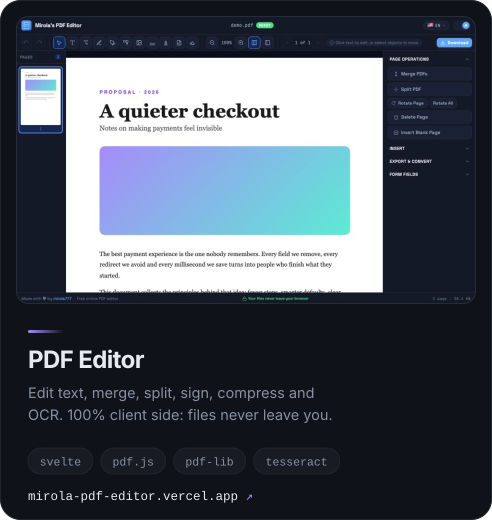
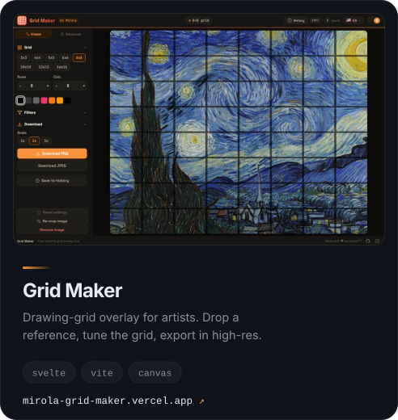

 

  
  

 

<picture>
  <source media="(prefers-color-scheme: dark)" srcset="https://raw.githubusercontent.com/mirola777/mirola777/output/snake-dark.svg" />
  <source media="(prefers-color-scheme: light)" srcset="https://raw.githubusercontent.com/mirola777/mirola777/output/snake-light.svg" />
  
</picture>

building payments by day, tiny apps by night &nbsp;·&nbsp; medellín, co

